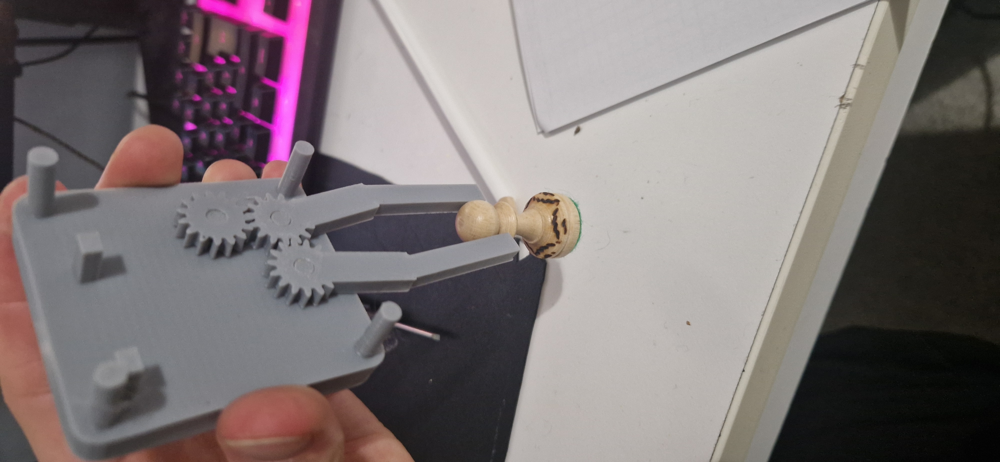

# ♟️ KnightShift
### A Robotic Chess Player

## What is KnightShift?

KnightShift is a robotic system designed to play chess against a human. It uses a robotic arm to move real chess pieces on a physical chessboard.

The project combines mechanical engineering, electronics, computer vision and programming.

## Why did I make this project?

I enjoy chess, robotics and engineering, so I wanted to combine these interests into one project.

My goal is to build a robot that can analyse a chess game, choose its own moves and physically move chess pieces on the board.

## How will it work?

1. A camera captures the chessboard.
2. The software analyses the board and detects the human player's moves.
3. The game state is updated.
4. Stockfish calculates the robot's response.
5. The software determines the movement for the robotic arm.
6. The robotic arm picks up and moves the chess piece.

The chess software is already able to analyse the board, detect moves, update the game state and calculate the robot's next move. Physical integration with the robotic arm is still in development.

## Mechanical Design

The robotic arm is designed in FreeCAD and will be mainly 3D-printed.

### Current progress

- Main mechanical components designed in FreeCAD.
- Gripper mechanism 3D-printed and assembled.
- Gripper successfully tested by picking up and lifting a chess piece.
- Cable-routing paths designed for the moving joints.
- Electronics compartment designed inside the base.
- Mounting hole for the DC power jack added.
- Further mechanical improvements and integration are in progress.

### Gripper test

The gripper has been physically tested and successfully lifted a chess piece.

## Electronics

The robot will use an ESP32 development board as its main controller.

Planned electronic components:

- ESP32-S3 – main controller.
- PCA9685 – servo controller module.
- MG996R servos – main arm joints.
- MG90S servos – smaller joints and gripper.
- External power supply for the servos.

Instead of designing a custom PCB, I decided to use ready-made electronic modules and create a wiring schematic in KiCad. This schematic will document how the components are connected.

### Electronics documentation

- [KiCad schematic](Schematics/KnightShift.kicad_sch)
- [PDF schematic](Schematics/KnightShift_Schematic.pdf)

## Software

The software is written in Python and uses computer vision and chess-engine libraries.

Main technologies:

- OpenCV – image processing and chessboard analysis.
- YOLO – object detection.
- python-chess – chess game logic and move validation.
- Stockfish – chess engine used to calculate moves.

### Current software capabilities

- Capturing and analysing the chessboard.
- Detecting human moves.
- Updating the game state.
- Calculating the robot's response using Stockfish.
- Displaying the move that the robotic arm should perform.

The next step is connecting the software with the physical robotic arm.

## Project Structure

- `CAD/` – 3D models and mechanical designs.
- `Schematics/` – KiCad wiring schematics.
- `Code/` – software and firmware.
- `Images/` – project photos and screenshots.

## Current Status

**Work in progress.**

The chess software is already able to analyse the board and calculate the robot's next move. The gripper has also been physically tested and successfully lifted a chess piece.

I am currently working on the electronics documentation and integrating the mechanical and electronic systems.

### Next Steps

- Finish the mechanical design.
- Complete the KiCad wiring schematic.
- Prepare the electronics and power connections.
- Connect the robotic arm with the chess software.
- Calibrate the arm and test physical chess moves.

## Demo

Videos and additional demonstrations will be added as the project develops.

## Author

Created by me as part of **Hack Club Fallen**.
.
